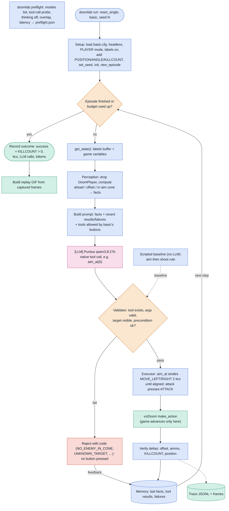

# DoomLab

An agent runtime that plays vizDoom through **typed tool calls**, then evaluates itself and improves from failures and human corrections.

Status: **Day 1 done** (commit `d37d4bf`): Qwen plays `basic` through typed tool calls, with traces and verified replays. **Day 2 in progress:** blocks 1–5 done (new tools, graph runner with recovery, commander topology, random baseline, `doomlab eval`); the pilot run is next.

- Spec: [`docs/superpowers/specs/2026-09-22-doomlab-design.md`](docs/superpowers/specs/2026-09-22-doomlab-design.md)
- Schedule (Wed → Fri): [`docs/superpowers/plans/2026-09-23-doomlab-schedule.md`](docs/superpowers/plans/2026-09-23-doomlab-schedule.md)
- Day 1 plan and walkthrough: [`schedule/day1.md`](schedule/day1.md) · Day 2 plan: [`schedule/day2.md`](schedule/day2.md) · Day 3 plan: [`schedule/day3.md`](schedule/day3.md)
- Full architecture diagram (Lucid, 2 pages): [runtime loop + evals/improvement](https://lucid.app/lucidchart/cfc18bb2-f111-478e-a9fd-f9d1de1d6a1d/edit)

## Day 1: single-agent loop on `basic`

Editable Lucid version: [DoomLab Day 1: Single-Agent Loop on basic](https://lucid.app/lucidchart/b33933f5-b78b-441e-bc77-c383eea49ff8/edit)

**Colors:** pink = LLM · blue = plain code · orange = decision point · mint = game / evidence · red = rejection.

**How it works in one paragraph:** vizDoom runs in synchronous `PLAYER` mode, so the game is paused while Qwen thinks. Each step, code turns the labels buffer and game variables into facts (e.g. "Cacodemon 384u ahead, 20u left, not in aim cone"). The LLM answers with one tool call. Code validates it, then the executor translates it into `make_action` button presses. `basic` has no turn buttons, so `aim_at` strafes. The result is verified from before/after game state, stored in memory, and written to a JSONL trace used for replays and metrics.
