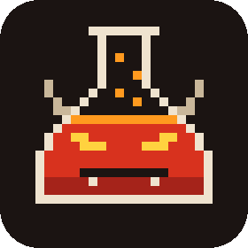
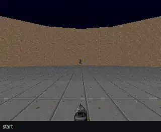
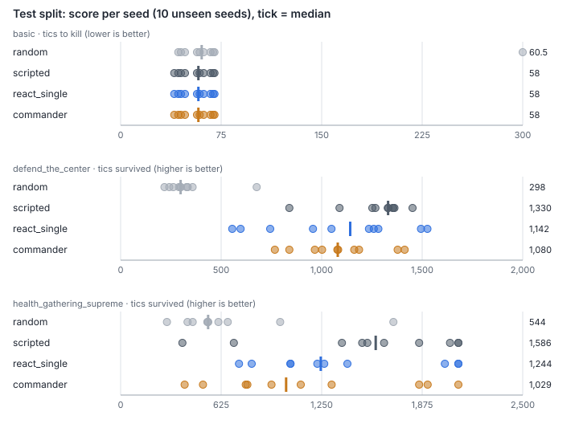
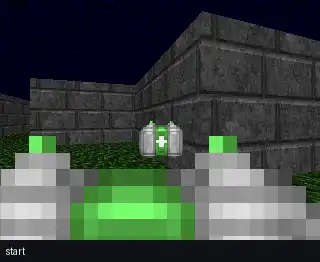
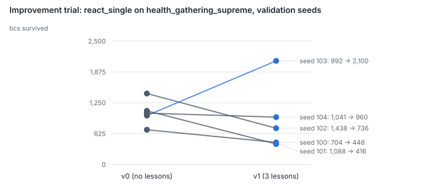

<p align="center">
  
</p>

<h1 align="center">DoomLab</h1>

I wanted to know what it actually takes to make an LLM agent play a game well, and how to measure that honestly. So I built a small harness around vizDoom where an LLM (Qwen, served by Purdue's GenAI Studio) plays by calling typed tools, and every decision gets validated, recorded and scored.

It turned into more of an evaluation project than a game-playing one. The short version: the LLM agents play far better than random, they still lose to four hand-written rules, and my own automated "improvement" step made the agent worse while every offline test said it was better. I wrote both of those up below.

## What's in here

Four players go through the same harness on the same levels:

- `random` picks any allowed tool at random
- `scripted` is four if/else rules (aim, shoot, grab medikit, look around)
- `react_single` is one Qwen agent choosing one tool call per turn
- `commander` is a Qwen commander that picks a job (fight or navigate) and hands off to a specialist that only has that job's tools

The agents never press buttons themselves. They ask for things like `aim_at(target_id=3)` or `go_to(target_id=12)`, an executor checks the request (is that target visible, is anything in the aim cone, is this tool allowed here) and only then turns it into game input. Bad requests get rejected with a reason, and three rejections in a row ends the agent's turn.

The game runs in synchronous mode, so it's paused while the model thinks. Every step is written to a JSONL trace, and any episode can be replayed frame for frame from its trace. That's what every number in this repo comes from.

```
game state -> facts -> agent picks a tool call -> executor validates -> buttons -> trace
                                  ^                                              |
                                  |____________ router / recovery _______________|
```

Here are all four on the same unseen `defend_the_center` level (test seed 1000). The caption under each frame is the tool call that agent made.

<table align="center">
  <tr>
    <td align="center"><br><code>random</code>: 334 tics</td>
    <td align="center"><br><code>scripted</code>: 1,329 tics</td>
  </tr>
  <tr>
    <td align="center"><br><code>react_single</code>: 1,526 tics</td>
    <td align="center"><br><code>commander</code>: 1,413 tics</td>
  </tr>
</table>

On this one seed both LLM agents outlasted the scripted rules. Over all ten test seeds they didn't (see below).

## Results

Held-out test split: 10 seeds the agents never saw during development, 120 episodes, everything run on one frozen recipe (`frozen-v0`, hash `af2ab05f5f7c`). Median score, with levels won in brackets.

| Scenario | random | scripted | react_single | commander |
|---|---|---|---|---|
| basic (tics to kill, lower is better) | 60.5 (9/10) | 58 (10/10) | 58 (10/10) | 58 (10/10) |
| defend_the_center (tics survived) | 298.5 (0/10) | 1,330.5 (0/10) | 1,142 (0/10) | 1,080 (0/10) |
| health_gathering_supreme (tics survived) | 544 (0/10) | 1,586 (2/10) | 1,244.5 (2/10) | 1,029 (1/10) |

A few things worth saying about that table:

- `basic` doesn't separate anyone. The `aim_at` tool does the precise aiming, so anything that eventually aims and shoots gets the same time. I keep it as a smoke test.
- On the two survival scenarios, the Qwen agents are roughly 2x to 4x the random floor but below the scripted rules.
- The two-specialist commander team didn't beat the single agent. Its combat specialist almost never fired blind (4 times vs 32), but that didn't turn into a better score.
- n = 10 per cell, so the success-rate intervals are wide. `results/metrics.md` has them.

<p align="center">
  
</p>

The full tables, per-seed scores with episode ids, and the raw traces are in [`results/`](results/). `uv run doomlab report` rebuilds all of it from the traces.

## Two things I found

**[1 in 5 LLM decisions looked at a paused game.](findings/2026-09-27-needless-observe.md)** The game pauses between decisions and every prompt already includes the current view, so `observe` can never show anything new. The model called it anyway: 663 of 3,369 test decisions (19.7%), and 18.9% on dev. The commander's narrow roles cut blind shots from 32 to 4, but the team still didn't score higher.

**[The lesson fixed the metric, not the game.](findings/2026-09-27-fixed-the-metric-not-the-game.md)** I corrected 11 bad decisions and had an LLM propose three prompt lessons for a v1 policy. Offline, v1 looked better: it passed 7/11 corrected decisions (v0 passed 3/11) and `observe` calls fell from 41 to 3. In full games it survived shorter on 4 of 5 validation seeds, because it swapped looking for turning back and forth on the spot. The gate said PROMOTE on one extra win. I rejected it, and the gate now has a "no broad decline" guard. A check on single decisions can't catch a failure that builds up over a whole episode.

<table align="center">
  <tr>
    <td align="center"><br>v0 (no lessons): 1,088 tics</td>
    <td align="center"><br>v1 (3 lessons): 416 tics</td>
  </tr>
</table>

<p align="center">
  
</p>

I reviewed all 11 corrections: I wrote two, and AI drafted the other nine. Each one is labelled with its author in `corrections/corrections.jsonl`.

## Running it

You'll need Python 3.14 and [uv](https://docs.astral.sh/uv/). vizDoom comes in as a normal dependency.

```sh
uv sync
cp .env.example .env        # then put your Purdue GenAI Studio key in it
uv run pytest               # ~290 tests, no network needed
```

The free agents don't need a key:

```sh
uv run doomlab run --variant scripted --scenario defend_the_center --seeds 0-4
uv run doomlab replay runs/<folder>/<episode>.jsonl     # re-checks the trace and writes a GIF
```

With a key:

```sh
uv run doomlab preflight                  # checks the endpoint, tool calling, decoding settings
uv run doomlab eval --split dev           # all agents x scenarios x seeds, resumable
uv run doomlab report                     # rebuilds results/ from the traces
```

The rest of the loop is `doomlab review` (correct flagged decisions), `doomlab regress`, `doomlab mine` and `doomlab improve`. `uv run doomlab --help` lists everything.

Purdue's docs say 60 requests a minute, but in practice the 21st request inside any minute gets refused, so the client paces itself at 18/min. The measurements are in [`data/rate_limit_probe.json`](data/rate_limit_probe.json). A full test run takes about three and a half hours mostly for that reason.

## Demo

There's a static page in [`demo/`](demo/) with all four agents playing the same unseen level side by side, plus the results and both findings. It doesn't need a key:

```sh
python3 -m http.server 4173 --bind 127.0.0.1 --directory demo
```

## Layout

```
src/doomlab/
  env/        vizDoom session + perception (game state -> facts)
  tools/      tool registry and the executor (the only code that touches the game)
  agents/     random, scripted, react_single, commander + prompts
  graph/      the small state-graph engine and router
  eval/       eval harness and scorers
  review/     correction review and regression checks
  improve/    failure miner, analyst, trial, promotion gate
  report/     results report and charts
results/      metrics, per-seed tables, charts, archived traces
findings/     the two write-ups
schedule/     day-by-day build notes (day1.md, day2.md, day3.md)
```

## Limits

One model, three scenarios, ten test levels per cell. `defend_the_center` scores are survival within an equal budget of 150 LLM calls, and both LLM agents ran out on some levels. A hosted model also isn't fully repeatable at temperature 0, which is why the regression checks ask each question three times. I'd treat everything here as a careful pilot, not a benchmark result.

## What's next

Things I want to try: an MCP server so other agents can use the same tools, a LangGraph port of the runner to compare against my own, a second improvement round aimed at the turning problem, and a small dashboard for reviewing decisions instead of the terminal.

The original design notes and the architecture diagram are [here](https://lucid.app/lucidchart/cfc18bb2-f111-478e-a9fd-f9d1de1d6a1d/edit), and the build log for each day is in [`schedule/`](schedule/).
